# PackRAG-MoR v1.3 product implementation

The current product is developed incrementally in the existing repository. PLAN.md and STATUS.md govern its gates. M0/M1 are verified; M2 is still being validated. This directory is not yet a completed release or the full v1.3 Definition of Done.

The real desktop path is `product/packrag`. The clean Android application is `product/android`, package `org.packrag.product`. It embeds the pinned Granite ONNX encoder and llama.cpp JNI CPU runtime. Model bytes are installed separately; APKs and KPack archives do not contain model weights.

The preserved working path is:

```mermaid
flowchart LR
  Q[Question] --> P[Verified active KPack]
  P --> R[Eligible aliases + FTS5 + dense / RRF]
  R --> A[Relevance admission]
  A --> S[Actual LFM token budgets / evidence selection]
  S --> G[Persistent LFM context reset / generation]
  G --> V[Buffered reasoning removal / output checks]
  V --> O[Accepted cited answer or deterministic abstention]
  O --> C[Canonical source and provenance]
```



## Current verified scope

Desktop: 74 combined product/legacy tests and 14 actual integrated smoke cases. Android: 44 exact Granite tokenizer cases, four numeric encoder vectors, ten actual retrieval order/rank/fusion/cosine cases, import security negatives, registry reopening and ten complete actual GGUF-tokenizer/prompt/evidence-budget parity cases. These are development fixtures, not calibrated release packs or PackBench.

The full Android weight-inference test is recorded separately from vocabulary-only parity. Read STATUS.md for its latest result. Current developer builds use a debug-only public key and show developer-pack mode. Release trust/lifecycle, complete UI/retrieval, both real packs, translation/gold review, evaluations and release/resource acceptance remain gated work.

## Reproduce on this workstation

Use the pinned existing Python environment, vendor toolchain and assets. Always choose fresh output directories:

```powershell
.venv-pack/Scripts/python.exe -X utf8 -m pytest tests product/tests -q -p no:cacheprovider --basetemp artifacts/v1.3/m2/NEW-RUN/pytest-temp --junitxml artifacts/v1.3/m2/NEW-RUN/combined-junit.xml
.venv-pack/Scripts/python.exe -X utf8 -m scripts.v13_smoke --run artifacts/v1.3/m2/NEW-SMOKE
scripts/v13_build_android.ps1 -RunDirectory artifacts/v1.3/m2/NEW-BUILD -Offline
.venv-pack/Scripts/python.exe -X utf8 -m scripts.v13_install_phone_assets --serial R3CT908DHHR --run artifacts/v1.3/m2/NEW-ASSET-RUN --include-generator
.venv-pack/Scripts/python.exe -X utf8 -m scripts.v13_test_android --serial R3CT908DHHR --build artifacts/v1.3/m2/NEW-BUILD --run artifacts/v1.3/m2/NEW-PHONE-RUN --class-name org.packrag.product.ProductE2eTest --result-file m2-product-e2e.json --timeout 2400
```

Pre-create the Python result parent. Windows test temporary-directory ACLs and build dependency/cache access may require approved tool execution. Do not install a new APK while another instrumentation run is active. The build helper verifies clean exact-commit llama.cpp source and captures product/config hashes before build; current tool locations come from the preserved workstation inventory. A complete clean-host bootstrap and final release instructions are M8 deliverables.

The owner manually supplied the exact GGUF; do not redownload or replace it. `scripts/v13_acquire_granite.py` acquires the pinned official embedding assets when needed. `product/config/toolchain.lock.json` binds model, tokenizer, ONNX, template, license, runtime and toolchain identities. Debug phone assets are private to the app UID and fully hashed before rename. No radio changes, root or broad storage privileges are required. Preserve the owner's mobile-data connection; app INTERNET capability is removed and asserted on device.

## Evidence and limitations

New outputs are under `artifacts/v1.3`, each with a versioned run name. Historical model/phone/pack evidence and FULL DOCUMENTATION remain immutable. The existing KPack format library/schema is audited shared format code, not a historical experiment runner. Do not run the legacy builder against historical fixture/output paths.

Read `docs/v1.3/M1_WALKING_SKELETON.md` and `docs/v1.3/M2_ANDROID_INCREMENT_LOG.md` for exact procedures, failures, repairs, acceptance predicates and interpretation limits. Component parity is not an accuracy benchmark. Citation syntax is not a semantic support proof. Development smoke expected-fact predicates are explicitly bounded and separate from complete release gold/human review. Timing records distinguish cold initialization, prefill, decode and first model token, which includes hidden reasoning; buffered UI visibility occurs later. Momentary scheduling/memory samples do not establish peaks or causal bottlenecks.

No private publisher key is committed or included in an Android asset. Large regenerable APKs are retained locally and hash-bound by evidence manifests but excluded from Git checkpoints. Model weights/exports are excluded from source distribution by the owner's instruction; final packaging must include their hashes and reproduction/acquisition instructions.
